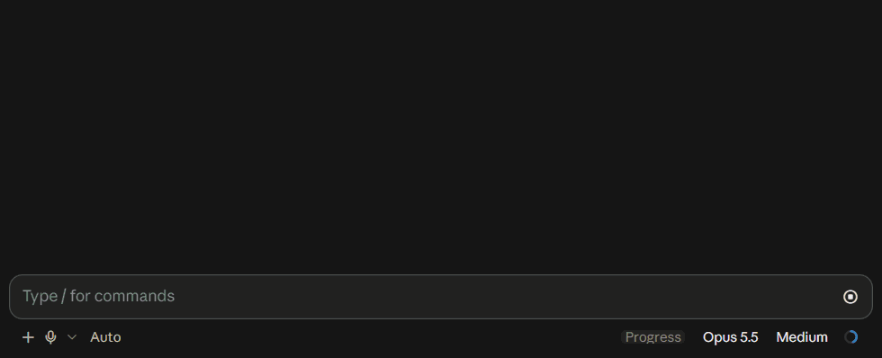

# Claude Code mods

**English** · [Русский](README.ru.md) · [简体中文](README.zh-CN.md) · [日本語](README.ja.md) · [한국어](README.ko.md) · [Español](README.es.md) · [Português](README.pt-BR.md) · [Deutsch](README.de.md) · [Français](README.fr.md)

## plan-progress

Live progress bars above the Claude Code prompt. Claude splits a task into stages and steps, and the bar fills as it works. The subagents for each task are listed under its bar.



[Watch with sound (MP4, 14 s)](media/plan-progress.mp4)

- One row per task: state, title, bar, percent, close button
- The pill on the bar shows the current stage and step; hover it for the time spent so far
- Stages are capsules, steps are dots; hover a passed one to see how long it took, one ahead to see what starts there
- A finished bar turns green, shows the total time and stays until it is closed; with `/plan-progress-autoclose` on, it leaves after `doneBarSeconds` (30 s by default, in `/config`)
- The dots of the fill and of the subagent rows twinkle; turn `twinkle` off in `/config` to draw them still
- Four states: running, needs input, error, done
- Each subagent gets a row under its task: name, model and effort, current tool, time
- The plan can change mid-run; finished steps are kept by title
- Bars are saved per session and come back when the session is resumed
- Short sounds for a question, an error and completion
- The footer shows how fast the main conversation writes, `⚡ N tok/s`; subagents are not counted
- The ⚙ next to it (in the desktop app and the fullscreen terminal) opens a settings window: effects, auto-close and its seconds, sounds, the figure itself, the mod's version and the update check; `/plan-progress-settings` opens it anywhere. The window speaks the language set in `/config`, else the app's, else the system's
- Updates: the version in the settings window, pressed, looks for a newer release, and Update installs it and reloads the mod in place (if the reload does not take, it asks for a restart). Once every 6 hours the mod also checks by itself and marks the ⚙ with 🔹 (● in the terminal) when a new version is out. A check is one request to the GitHub API (`api.github.com/repos/zycck/claude-mods/releases`), with no account or session data in it; turn it off with Check for updates in the window or with `CLAUDE_CODE_DISABLE_NONESSENTIAL_TRAFFIC`. A copy installed from a folder is not checked
- Works in the desktop app and in the terminal
- In the terminal the bar follows a light or dark GNOME desktop with the `auto` theme, and takes the colors of the active Omarchy theme

### Install

Requires Claude Code 2.1.295 or newer (`claude --version`; `claude update` to upgrade). On older versions parts of the mod do not work: the settings window stays empty, and before 2.1.286 the hooks module does not load at all, no bars appear and the startup banner says `plan-progress: hooks module did not load`.

```
/plugin marketplace add zycck/claude-mods
/plugin install plan-progress@zycck-mods
```

Update:

```
claude plugin marketplace update zycck-mods
claude plugin update plan-progress@zycck-mods
```

### Commands

- `/progress` shows or hides the bars
- `/progress-clear` removes all bars
- `/progress-agents` folds the agent strips under the bars, or shows them again (the chevron button next to a bar's ✕ does it for that bar)
- `/plan-progress-autoclose` turns on finished bars leaving on their own (off by default), or turns it off again; the choice is kept across sessions
- `/plan-progress-settings` opens the settings window, as the ⚙ in the footer does (in the terminal the ⚙ is shown only in fullscreen)

### How it works

The mod registers a `plan_progress` tool. Claude sends the plan once, then short updates such as `{id, next: true}` or `{id, done: ["Routes"]}`. An unknown step name is refused with the list of the bar's steps. A plan approved in plan mode becomes the bar `plan`. Agent rows come from engine events and cost no tokens.

On the desktop the bar is an SVG image with a hover layer on top. In the terminal it is a character grid that animates only while Claude is working.

### Tests

`plugins/plan-progress/tests` runs the real module against a stub engine: `node compile.cjs ../hooks/register.tsx register.mjs`, then `node regress.mjs` and `node scenarios.mjs`.

## License

MIT
